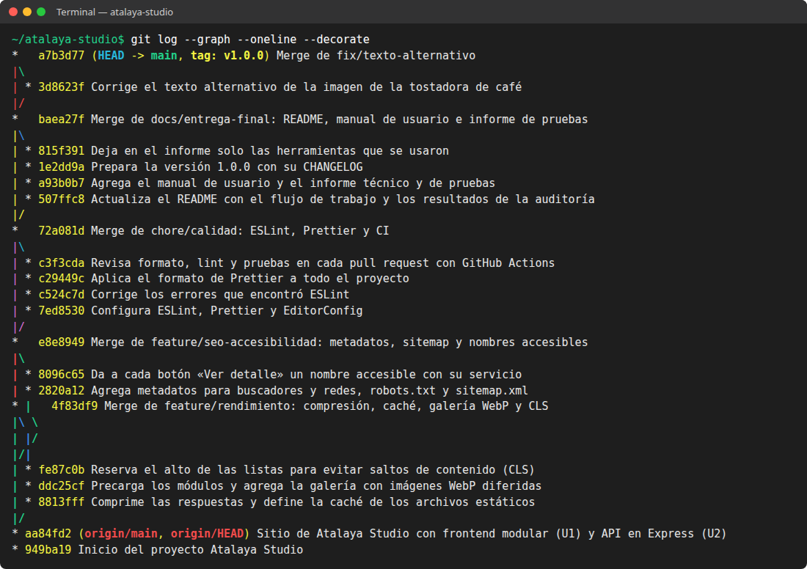
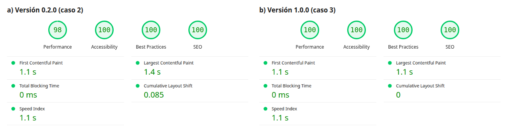
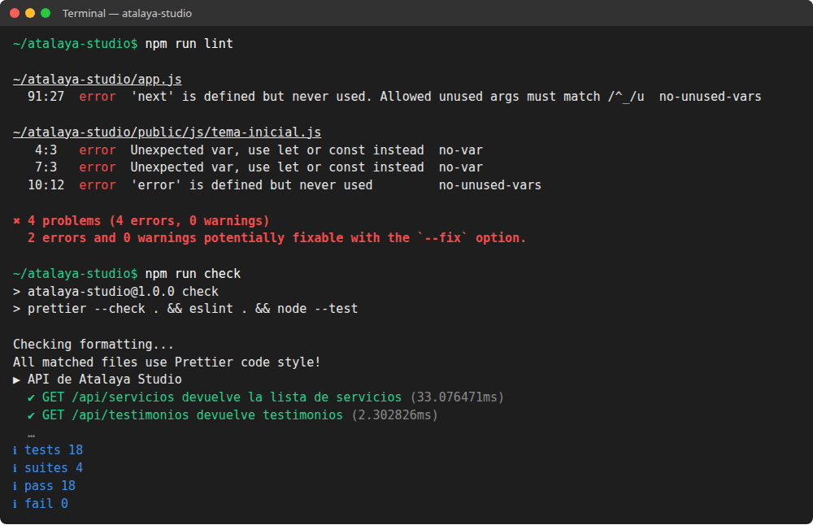
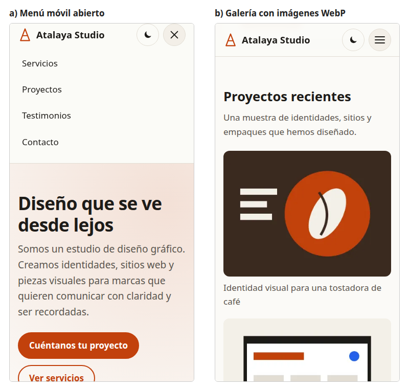

# Atalaya Studio: de la construcción a la presentación del proyecto web final

**Caso Práctico Unidad 3**

| | |
|---|---|
| **Estudiante** | Fabián Alexis Jaimes Gelves |
| **Docente** | John Jairo Sedano Segura |
| **Asignatura** | Desarrollo Web |
| **Institución** | Corporación Universitaria de Asturias |
| **Año** | 2026 |

📄 Versión para descargar: [PDF](caso-practico-3-fabian-jaimes.pdf) · [Word](caso-practico-3-fabian-jaimes.docx)

---

## Solución al caso práctico

En los casos anteriores construí la landing de Atalaya Studio con módulos de una sola responsabilidad (*api.js*, *ui.js*, *form.js*, *storage.js*, *validacion.js*) y le di un backend propio en Express, almacenamiento local y un plan de despliegue. Este caso no pide funciones nuevas: pide convertir ese prototipo en un producto estable, rápido y documentado. Mi propuesta tiene cuatro partes: un flujo de trabajo con Git y GitHub (ramas, *pull requests* e integración continua), una ronda de optimización medida con Lighthouse, reglas automáticas de calidad y una auditoría final de experiencia de usuario, accesibilidad y SEO, acompañada de la documentación.

### 1. Efectos de la sobrescritura de archivos y las versiones incompletas en la calidad del proyecto

Un sistema de control de versiones guarda el historial completo del proyecto, permite volver a versiones anteriores y deja que varias personas trabajen en paralelo sin pisarse (REDSUMMA Education, s.f.-a). Sin él, los problemas que describe el equipo afectan la calidad de cuatro formas:

- **Trabajo perdido sin aviso:** si dos personas editan *form.js* en una carpeta compartida, gana quien guarda de último, y nadie se entera de lo que se perdió hasta que aparece un error.
- **Módulos que dejan de coincidir:** en el caso anterior el navegador y el servidor comparten las reglas de *validacion.js*. Si se sube la regla nueva pero no el cambio del servidor, cada lado valida distinto y el formulario rechaza datos correctos.
- **Errores sin rastro:** sin historial no se sabe qué cambió, cuándo ni por qué, así que encontrar la causa tarda más y no hay una versión buena a la cual volver.
- **Producción inestable:** publicar desde la copia de alguien es publicar lo que tenga en ese momento, a veces a medio terminar.

La calidad de un proyecto web no es solo que funcione hoy, sino poder confiar en que lo que se publica está completo y es coherente. Git cambia la naturaleza del problema: cuando dos ramas modifican la misma línea, no conserva en silencio la última versión, sino que detiene la fusión y muestra ambas (Figura 1).

*Figura 1. Conflicto que Git detecta cuando dos personas cambian la misma regla.*

```js
// validacion.js durante un merge: Git se detiene y muestra las dos versiones
export function validarContacto({ nombre = "", correo = "", mensaje = "" }) {
  const errores = {};
<<<<<<< HEAD
  if (mensaje.trim().length < 10) errores.mensaje = "Cuéntanos un poco más.";
=======
  if (mensaje.trim().length < 20) errores.mensaje = "Escribe 20 caracteres.";
>>>>>>> feature/mensaje-largo
  return errores;
}
```

Resolver el conflicto es una decisión del equipo, no de quien guardó primero: se conversa, se deja la regla correcta y se registra con un *commit* (REDSUMMA Education, s.f.-a). Lo que antes era una pérdida invisible se vuelve una pregunta explícita.

### 2. Git y GitHub para colaborar mejor y prevenir errores técnicos

Git funciona en el equipo de cada desarrollador y GitHub aloja el repositorio en línea para compartirlo y colaborar mediante ramas y *pull requests* (REDSUMMA Education, s.f.-a). Para Atalaya Studio propongo estas reglas:

- **Ramas por tarea:** *main* siempre está estable y nadie trabaja sobre ella; cada cambio vive en una rama *feature/*, *fix/* o *docs/* hasta que está listo.
- **Revisión antes de fusionar:** cada rama llega a *main* por un *pull request* que otra persona revisa, con una plantilla que pide decir qué cambia y cómo se probó.
- **Revisión automática:** GitHub Actions ejecuta formato, *lint* y pruebas en cada *pull request*; si algo falla, no se fusiona. En GitHub dejaría *main* protegida para que nadie pueda saltarse ese paso.
- **Historial legible:** *commits* pequeños con mensajes que dicen qué cambia, un *.gitignore* que deja fuera *node_modules* y *.env*, y una etiqueta *v1.0.0* que marca la versión entregada.

*Figura 2. Historial del proyecto con una rama por bloque de trabajo y la versión 1.0.0 etiquetada.*



Apliqué este flujo al cierre del proyecto. Cada bloque de trabajo de este caso (rendimiento, SEO y accesibilidad, calidad y documentación) se hizo en su propia rama y se integró con un *merge* que conserva su historia, que es lo que hace el botón de fusión de un *pull request* en GitHub (Figura 2). La revisión también funcionó: al revisar la galería noté que el texto alternativo de una imagen describía una taza cuando la imagen muestra un grano de café, y la corrección entró por su propia rama *fix/*.

Este flujo previene errores futuros porque los detecta antes de que lleguen a *main*: un conflicto aparece en la rama, una prueba rota detiene el *pull request* y, si algo se escapa, el historial permite saber qué lo causó y revertir solo ese cambio.

### 3. Estrategias para acelerar la carga en móviles sin perder calidad

Optimizar es hacer el sitio más rápido, eficiente y fácil de usar, y se mide con las Core Web Vitals: LCP por debajo de 2,5 s, FID por debajo de 100 ms y CLS por debajo de 0,1 (REDSUMMA Education, s.f.-d). Antes de cambiar nada, audité la versión del caso anterior con Lighthouse en modo móvil. El rendimiento era de 98, pero el informe señalaba tres problemas: el texto viajaba sin comprimir, los módulos de JavaScript se descubrían uno tras otro y el CLS llegaba a 0,085, casi en el límite, porque la sección de testimonios saltaba cuando terminaban de cargar los servicios. Con ese diagnóstico apliqué cuatro estrategias:

- **Comprimir y guardar en caché:** el servidor envía HTML, CSS, JS y JSON comprimidos con gzip; CSS, JS e imágenes se guardan un día en el navegador y el HTML se revalida en cada visita, para que los cambios lleguen enseguida (Figura 3).
- **Descargar en paralelo:** *modulepreload* anuncia los módulos desde el *head* para que el navegador no espere a leer *main.js* para pedirlos.
- **Imágenes ligeras y diferidas:** la galería nueva usa WebP en dos tamaños; el celular descarga la versión de 400 px y solo cuando la persona se acerca a ella (Figura 4).
- **Reservar el espacio:** las listas que llegan de la API tienen un alto mínimo mientras cargan, así no empujan el contenido.

*Figura 3. Compresión y política de caché en el servidor.*

```js
// app.js
import compression from "compression";

// El HTML se revalida en cada visita; CSS, JS e imágenes duran un día.
function cabecerasDeCache(res, ruta) {
  const esHtml = ruta.endsWith(".html");
  res.set("Cache-Control", esHtml ? "no-cache" : "public, max-age=86400");
}

export function crearApp(opciones) {
  const app = express();
  app.use(compression()); // gzip: HTML, CSS, JS y JSON viajan comprimidos
  // … rutas de la API del caso anterior …
  app.use(express.static(CARPETA_PUBLICA, { setHeaders: cabecerasDeCache }));
  return app;
}
```

*Figura 4. Precarga de módulos e imagen responsive con carga diferida.*

```html
<!-- index.html: en el <head>, los módulos se piden en paralelo -->
<link rel="modulepreload" href="js/api.js" />
<link rel="modulepreload" href="js/ui.js" />

<!-- Galería: width y height reservan el espacio y evitan saltos (CLS) -->

```

La segunda auditoría confirmó el efecto (Figura 5): el rendimiento subió a 100, el LCP bajó de 1,4 a 1,1 s y el CLS de 0,085 a 0. El peso de la página bajó de 46 a 41 KiB aunque se agregó una galería con tres imágenes, porque estas no se descargan hasta que se necesitan.

*Figura 5. Auditoría de Lighthouse en móvil antes (a) y después (b) de la optimización.*



La calidad no se sacrificó: el contenido es el mismo, WebP mantiene la nitidez con menos peso y cada pantalla recibe la imagen del tamaño que necesita. También tomé decisiones con el informe en la mano. Lighthouse estimaba que minificar el CSS ahorraba 3 KiB; con gzip activo esa ganancia era marginal, así que la dejé para cuando el proyecto tenga un proceso de compilación. Y mantuve como bloqueante el pequeño script que aplica el modo oscuro antes de pintar, porque quitarlo produce un destello de pantalla clara que empeora la experiencia más de lo que ahorra. Queda pendiente repetir la medición en un celular real con red móvil, porque Lighthouse simula esas condiciones.

### 4. Código legible, modular y fácil de actualizar en un proyecto que crece

Una buena arquitectura separa los archivos por tipo y función, evita nombres genéricos, documenta las funciones y mantiene una nomenclatura consistente (REDSUMMA Education, s.f.-c). Conservo lo que ya funcionaba y agrego herramientas que lo hacen cumplir:

- **Una responsabilidad por módulo:** como en los casos anteriores, *api.js* es el único que habla con el servidor y *storage.js* el único que toca el almacenamiento; cada pieza nueva sigue la misma regla.
- **Reglas automáticas:** ESLint detecta errores y malas prácticas, Prettier da el mismo formato a todo el código y EditorConfig iguala la sangría en cualquier editor.
- **Pruebas automáticas:** 18 pruebas con *node:test* cubren la API, la validación y, ahora, la compresión y la caché, para que nadie las rompa sin darse cuenta.
- **Documentación junto al código:** comentarios que explican el porqué, un README con la estructura y la forma de contribuir y un CHANGELOG con lo que trae cada versión.

*Figura 6. ESLint al activarse por primera vez y la revisión completa que corre en cada pull request.*



Las reglas automáticas importan porque las convenciones que dependen de la memoria se pierden cuando el equipo crece. Al activar ESLint por primera vez encontró cuatro errores que venían de los casos anteriores: dos variables declaradas y nunca usadas y dos *var* que debían ser *const* o *let*. Después de corregirlos, un solo comando revisa el formato, el *lint* y las pruebas, y es el mismo que ejecuta GitHub Actions en cada *pull request* (Figura 6).

Con esto, actualizar el sitio es más seguro: quien llegue al equipo encuentra en el README cómo está organizado el proyecto y, si su cambio rompe algo, la revisión automática se lo dice antes de llegar a *main*. Así, la revisión entre compañeros puede centrarse en la lógica y no en espacios o comillas.

### 5. Acciones de UX, accesibilidad y SEO antes de la presentación final

La integración final se comprueba con validadores, auditorías y pruebas funcionales; su objetivo no es la perfección, sino un sitio consistente, estable y usable (REDSUMMA Education, s.f.-c). Antes de presentar el proyecto tomaría estas acciones, que ya apliqué en la versión 1.0.0:

1. **Validar y auditar:** el validador del W3C no reporta errores en el HTML, y Lighthouse da 100 en accesibilidad, buenas prácticas y SEO. Cuando el sitio esté publicado, lo pasaría también por WAVE.
2. **Probar como una persona real:** recorrí el sitio solo con el teclado (orden lógico, foco visible y el menú móvil se cierra con Escape), lo revisé a 360 px de ancho y con zoom al 200 % sin desplazamiento horizontal, y probé el formulario vacío, con un correo inválido, con un envío correcto y con seis envíos seguidos.
3. **Nombres accesibles claros:** los seis botones «Ver detalle» sonaban iguales para un lector de pantalla; ahora cada uno anuncia su servicio («Ver detalle de Ilustración») y el texto visible no cambia (World Wide Web Consortium [W3C], 2023).
4. **SEO técnico:** título y descripción propios, URL canónica, vista previa para redes (Open Graph), datos estructurados de schema.org, *robots.txt*, *sitemap.xml*, jerarquía de títulos ordenada y texto alternativo que describe cada imagen (Figura 7).
5. **Diseño para cada dispositivo:** menú plegable con botones fáciles de tocar e imágenes que se adaptan al ancho de la pantalla (Figura 8). Falta repetir el recorrido en Firefox, Edge, Safari y un celular real, porque el simulador no reemplaza al dispositivo.

Por último, la entrega incluye la documentación en sus tres niveles (REDSUMMA Education, s.f.-b): técnica, con el README y un informe de pruebas que registra las auditorías y las mejoras; funcional, con un manual de usuario en lenguaje sencillo que explica la navegación, el formulario, el modo oscuro y los errores comunes; y ejecutiva, con una presentación de unos cinco minutos. En ella no diría «agregué un *aria-label*», sino «cualquier persona, también quien usa un lector de pantalla, sabe qué servicio va a abrir», y mostraría las puntuaciones de Lighthouse como evidencia.

*Figura 7. Metadatos para buscadores y redes sociales.*

```html
<!-- index.html: <head> -->
<title>Atalaya Studio | Diseño gráfico e identidad visual</title>
<meta name="description" content="Atalaya Studio es un estudio de diseño…" />
<link rel="canonical" href="https://atalaya-studio.onrender.com/" />
<meta property="og:title" content="Atalaya Studio | Diseño gráfico…" />
<meta property="og:image" content="…/img/proyecto-cafe-800.webp" />
<!-- Datos estructurados: le dicen al buscador qué es el sitio -->
<script type="application/ld+json">
  {
    "@context": "https://schema.org",
    "@type": "ProfessionalService",
    "name": "Atalaya Studio",
    "address": { "@type": "PostalAddress", "addressLocality": "Bogotá" }
  }
</script>
```

*Figura 8. El sitio a 360 px: menú móvil abierto (a) y galería con imágenes WebP (b).*



## Aplicación Práctica del Conocimiento

Este caso me mostró que un sitio que funciona todavía no es un producto. Lo que lo convierte en uno es lo que no se ve en la pantalla: un historial que permite saber qué cambió y volver atrás, mediciones que reemplazan las suposiciones y revisiones automáticas que atrapan los errores antes que los usuarios. También aprendí a medir antes de optimizar: la página ya parecía rápida, pero la auditoría reveló un salto de contenido que no había notado y que se corrigió con una línea de CSS. Ese hábito de medir, cambiar y volver a medir, con cada paso registrado en Git, se aplica a cualquier proyecto web que deba crecer sin romperse.

## Referencias

Asturias Corporación Universitaria. (s.f.). *Caso práctico unidad 3. Enunciado: Atalaya Studio: de la construcción a la presentación del proyecto web final*. https://www.centro-virtual.com/recursos/casos_practicos/CUA-E-DWEB_u3.pdf

REDSUMMA Education. (s.f.-a). *Control de versiones y trabajo colaborativo con Git y GitHub* [Nota técnica]. Asturias Corporación Universitaria. https://www.centro-virtual.com/recursos/biblioteca/pdf/CUA-E-DWEB/unidad3_pdf1.pdf

REDSUMMA Education. (s.f.-b). *Documentación y presentación profesional del proyecto web* [Nota técnica]. Asturias Corporación Universitaria. https://www.centro-virtual.com/recursos/biblioteca/pdf/CUA-E-DWEB/unidad3_pdf4.pdf

REDSUMMA Education. (s.f.-c). *Integración del proyecto final: Arquitectura, revisión y pruebas* [Nota técnica]. Asturias Corporación Universitaria. https://www.centro-virtual.com/recursos/biblioteca/pdf/CUA-E-DWEB/unidad3_pdf3.pdf

REDSUMMA Education. (s.f.-d). *Mantenimiento y optimización del sitio web* [Nota técnica]. Asturias Corporación Universitaria. https://www.centro-virtual.com/recursos/biblioteca/pdf/CUA-E-DWEB/unidad3_pdf2.pdf

World Wide Web Consortium. (2023). *Web Content Accessibility Guidelines (WCAG) 2.2*. https://www.w3.org/TR/WCAG22/
